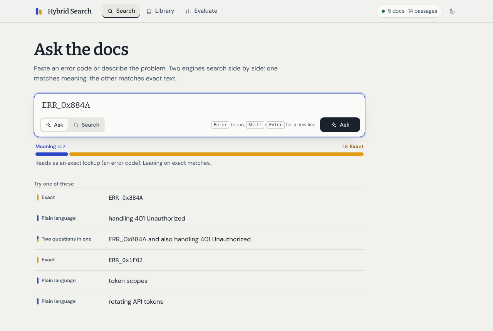
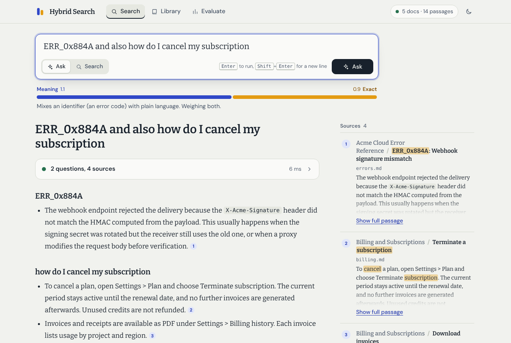
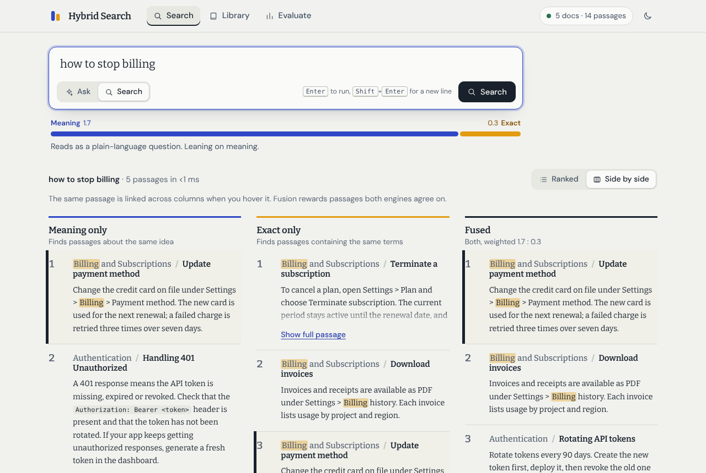
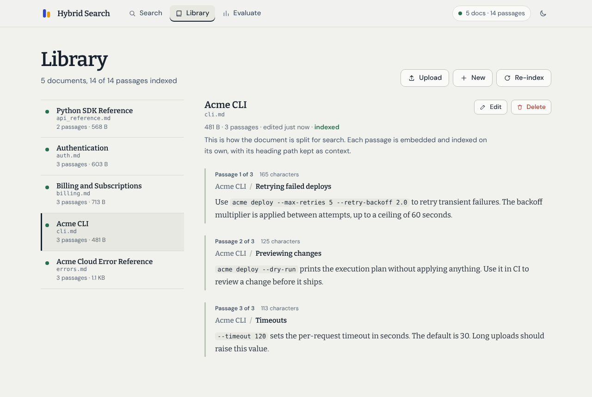
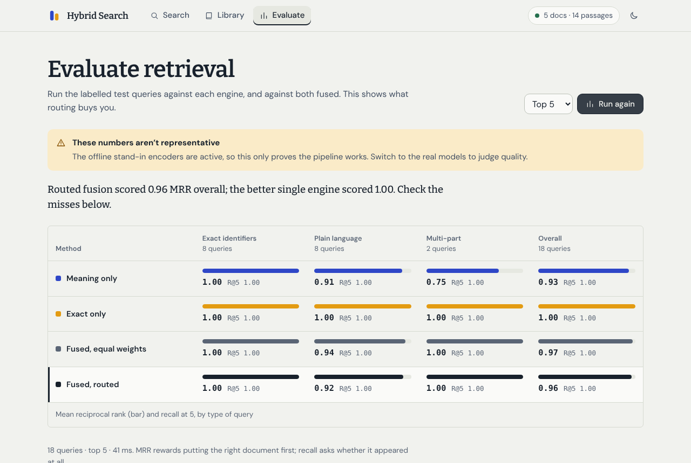

# Agentic Hybrid Search Router

Documentation search for developers that handles **both** `ERR_0x884A` (exact identifiers) **and**
"how to stop billing" (concepts), then goes further: it splits multi-part questions, checks its own
results, rewrites failed queries, and falls back to external tools. It ships with a web UI that shows
*how* it found each answer.



```
question ─► decompose ─┬─► research(sub-query 1) ─┐
                       ├─► research(sub-query 2) ─┼─► synthesize ─► answer + citations
                       └─► research(sub-query N) ─┘
research =  retrieve ─► grade ─┬─ relevant ───────────────────────► finish
              ▲                ├─ not relevant, retries left ─► rewrite ─┐
              └────────────────┘                                          │
                               └─ retries exhausted ─► tools (code / issues) ─► finish
                                   (nothing at all? the closest matches are kept, flagged "unconfirmed")

retrieve = router ─► dense (Qdrant "dense") ─┐
                 └─► learned sparse ("sparse") ─┴─► weighted RRF
```

## Quickstart (no GPU, no downloads, no API key)

```bash
pip install -e ".[dev]"
ENCODER_BACKEND=hash QDRANT_URL=:memory: make serve      # then open http://localhost:8000
make test                                                # Python + UI unit tests, fully offline
```

`ENCODER_BACKEND=hash` uses offline stand-in encoders so the whole pipeline runs anywhere. They are for
CI and demos, **not** for judging retrieval quality; the UI says so (banner + Evaluate page) while active.

## The interface

The UI is served by the API at `/` (no build step, no CDN: plain ES modules, self-hosted fonts, strict CSP).

| | |
|---|---|
| **Live routing.** The bar under the search box shows how the router weighs *Meaning* (dense, cobalt) against *Exact* match (sparse, amber) as you type. The same two colours mark each result's per-engine rank and highlight exact matches. |  |
| **Ask** streams the agent's work (split, search, check, rewrite, fall back) and renders the answer with clickable `[n]` citations and a sources rail. **Search** returns ranked passages; **Side by side** shows Meaning-only, Exact-only and Fused so you can see why fusion helps. |  |
| **Library**: upload (drag & drop), write, edit and delete Markdown documents, each indexed instantly. The reader shows how a document is split into passages. |  |
| **Evaluate** runs the labelled queries through every method, with a per-query breakdown of where each one misses. |  |

Keyboard: `/` focuses search · `Enter` runs · `Shift+Enter` new line · `Ctrl/Cmd+Enter` runs in the other mode.
Light and dark themes follow the system and can be toggled. The UI is responsive down to phone width.

## Real models

```bash
pip install -e ".[dev,ml]"
cp .env.example .env            # ENCODER_BACKEND=hf, set ANTHROPIC_API_KEY for the Claude-powered agent
docker run -p 6333:6333 qdrant/qdrant
make ingest && make serve
```

`.env` is loaded automatically (real environment variables take precedence).

| Component | Default | Notes |
|---|---|---|
| Dense | `BAAI/bge-small-en-v1.5` | CLS pooling, query prefix; swap for your fine-tuned checkpoint |
| Learned sparse | `naver/splade-cocondenser-ensembledistil` | `log(1+ReLU(logits))` max-pooled over tokens; includes expansion |
| Router | heuristic (regex features) | set `ROUTER_MODEL` to blend in the fine-tuned DistilBERT |
| Agent LLM | Claude (`LLM_MODEL`) if `ANTHROPIC_API_KEY` set | otherwise deterministic offline extraction (the UI labels it "Quoted from sources") |

All settings, with defaults and comments, are in [`.env.example`](.env.example).

## Indexing

Indexing is **incremental and zero-downtime**. Chunk ids derive from content, so only new or changed
passages are embedded, removed ones are deleted *after* new ones are upserted, and search keeps working
throughout. The index syncs with `DOCS_DIR` at start-up (`AUTO_INGEST=1`), on every upload/edit/delete in the
UI, and via `make ingest` (`python -m ahsr.ingestion.ingest --full` rebuilds). Swapping the dense model (different vector size) is detected and
triggers a rebuild automatically instead of failing at upsert time.

## API

Interactive docs at `/docs`. Errors always look like `{"error": {"code", "message", "request_id"}}`.

| Endpoint | Purpose |
|---|---|
| `POST /search` `{query, top_k, mode}` | retrieval only; `mode` = `hybrid` (router-weighted RRF), `hybrid_flat`, `hybrid_server` (Qdrant-side RRF), `dense`, `sparse`. Returns the route decision, per-engine ranks, relative scores |
| `POST /route` `{query}` | just the router's decision (cheap; powers the live balance bar) |
| `POST /ask` `{question}` | full agent: answer, citations (with passage text), sub-queries, per-step records, trace |
| `POST /ask/stream` | same, as server-sent events: `start`, `decompose`, `research` (one per sub-question), `synthesize`, `done`, or `error` |
| `GET /suggestions` | example queries derived from your indexed corpus |
| `GET /documents` · `GET\|PUT\|DELETE /documents/{path}` | list, read (with passage split), create/replace, delete; PUT/DELETE re-index that document |
| `POST /ingest?full=false` | sync the index with `DOCS_DIR`; returns added/removed/unchanged counts |
| `POST /eval` `{k}` | run the labelled queries; aggregates plus a per-query breakdown |
| `GET /health` | status, counts, encoder/LLM mode, whether a key is required (503 if the vector store is down) |

## Security and operations

- **Auth:** set `API_KEY` to require `X-API-Key` on everything except `/health` and the static UI (the UI prompts for the key and keeps it in `sessionStorage` only). Keys are compared in constant time.
- **Rate limiting:** per-client token bucket (`RATE_LIMIT_PER_MIN`, default 120; agent calls cost 5, re-index/eval 20). Responses carry `Retry-After`. In-memory, so for multiple replicas use a shared limiter at your gateway. Set `TRUST_PROXY=1` only behind a proxy you control.
- **Input limits:** query length (`MAX_QUERY_CHARS`), document size and count. Document paths are validated (relative, `.md` only, no traversal or symlink escape) and writes are atomic.
- **Read-only mode:** `READ_ONLY=1` disables every mutation.
- **Browser hardening:** strict Content-Security-Policy (no inline script/style, no `eval`), `nosniff`, `X-Frame-Options: DENY`. Untrusted text (documents, model output) is rendered through a small safe Markdown renderer that never uses `innerHTML` and only allows `http(s)`, `mailto`, relative and `#` links.
- **Prompt injection:** the synthesis prompt treats retrieved passages as untrusted data.
- **Resilience:** the API waits for Qdrant at start-up; Anthropic calls have a bounded timeout and fall back to offline heuristics; a failing tool is isolated; `/ask/stream` always ends with `done` or `error`; the container runs as a non-root user.
- **Logging:** one access-log line per request with a request id (`X-Request-Id` is echoed back; send your own to correlate).

## Improving the models (the part that makes this yours)

```bash
make data            # synthesize (query, passage) pairs + router labels from data/docs
                     #   add --llm to have Claude write natural paraphrased queries
make train-router    # DistilBERT: identifier vs conceptual
make train-dense     # contrastive fine-tune, in-batch negatives (+ optional hard negatives)
make train-sparse    # SPLADE fine-tune: contrastive + FLOPS sparsity regulariser
# then point DENSE_MODEL / SPARSE_MODEL / ROUTER_MODEL at models/* and re-run: python -m ahsr.ingestion.ingest --full && make eval
```

## Evaluate

`make eval` prints a dense / sparse / flat-hybrid / router-hybrid table (Recall@k, MRR by query type); the
**Evaluate** page shows the same with a per-query drill-down. CI fails if router-hybrid MRR drops below a
threshold. Replace `data/docs` and `data/eval/queries.jsonl` with your real corpus and 100-200 labelled
queries before trusting any number.

## Deploy

- **Local/demo:** `make up` (Qdrant + API via Docker Compose; HF weights cached in a volume; documents bind-mounted from `./data`). Qdrant is published on localhost only.
- **Cloud:** Qdrant Cloud (free tier) + the Docker image on Cloud Run / Fly.io / Railway; set `QDRANT_URL`, `QDRANT_API_KEY`, `ANTHROPIC_API_KEY`, and **`API_KEY`** (the UI can edit your documents). Use a CUDA torch build for GPU hosts. Mount persistent storage at `/app/data` if users will upload documents, or set `READ_ONLY=1`.
- **Next for production:** shared (Redis) query-embedding cache and rate limiter, LangGraph checkpointer, Langfuse/LangSmith tracing, token-level answer streaming, multi-turn follow-ups.

## Testing

```bash
make test          # pytest (offline) + node --test for the UI's pure modules
make lint          # pyflakes + syntax check of every UI module
```

## Status

| Verified | Not yet verified |
|---|---|
| Chunker, router, weighted RRF, incremental sync, document library (path safety), rate limiter, config loader, service layer, agent loop incl. weak-match and tool-failure paths, offline end-to-end. UI exercised in headless Chromium: live routing, streamed Ask, Search/Compare, Library CRUD + upload + drag-drop, Evaluate, API-key flow, read-only mode, offline errors, dark theme, mobile width, under the strict CSP | The HTTP layer (`api/main.py`, `tests/test_api.py`) and the Docker image were written but **not executed**: run `make test` and `docker compose up --build` once. Anything needing downloaded weights: `HFDenseEncoder`, `HFSparseEncoder`, `TransformerRouter`, the training scripts |
| Offline synthetic-data generation | `ClaudeLLM` prompts (no API key in the build environment); `GitHubIssuesTool` live calls |
| | Retrieval quality on a real corpus: the bundled 5-doc eval is a smoke test, and the hash encoders' synonym table was written with this corpus in mind |

## Layout

```
src/ahsr/
  models/      dense.py sparse.py hashing.py cached.py   encoders (PyTorch/HF + offline stand-ins, query cache)
  router/      heuristic.py classifier.py                 query router
  ingestion/   chunker.py library.py ingest.py            chunking, safe document store, incremental indexing
  retrieval/   store.py hybrid.py                         Qdrant wrapper, weighted RRF
  agent/       graph.py llm.py                            LangGraph workflow, Claude/offline LLM
  tools/       external.py                                code search, GitHub issues
  service.py   suggest.py                                 framework-free application layer (what the API calls)
  api/         main.py                                    FastAPI: auth, limits, errors, SSE, static UI
  web/                                                    the UI: index.html, css/, js/ (ES modules), fonts/
  eval/        evaluate.py                                ablation + CI gate
  training/    synth_data.py train_*.py                   data synthesis and fine-tuning
tests/         pytest suite; tests/web/ = node:test for Markdown parser, highlighter, term matcher
```

Fonts: Bitter and DM Sans (SIL OFL, licences in `src/ahsr/web/fonts/`), DejaVu Sans Mono (Bitstream Vera licence).
